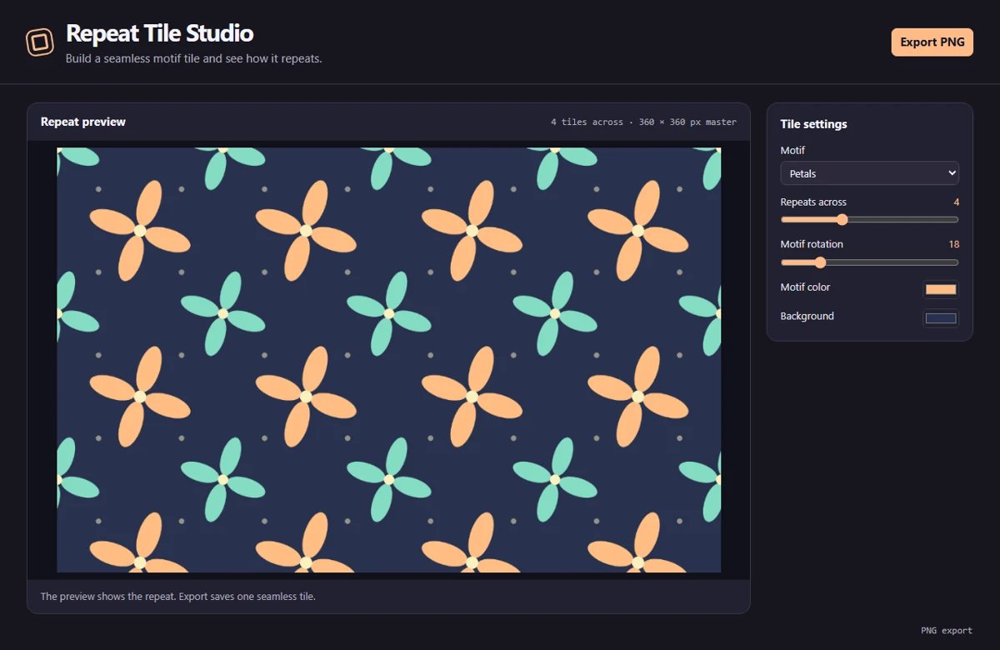

# Repeat Tile Studio

Design seamless repeating tiles with rotating petal, diamond, or arch motifs, color controls, and a reusable PNG export.



## Run locally

Install Node.js 24 and npm. From the repository directory, run:

```sh
npm ci
npm start
```

The first command installs the locked dependencies. The second opens the desktop window and may download the pinned Electron runtime on first launch. All artwork is processed locally. The app requires no account or API key.

## Use the app

Pick a motif, change rotation and colors, and adjust the number of repeats visible across the preview. The corner motif wraps across tile edges. Export produces a 360 × 360 PNG for use as a repeating image.

The repeat count affects only the preview.

## Project layout

- `main.cjs` creates the Electron window and handles native export dialogs.
- `preload.cjs` exposes the small set of desktop operations available to the renderer.
- `app.js` manages shared controls, canvas input, and export encoding.
- `tool.js` contains this app's drawing and editing logic.

## Verify

```sh
npm test
```

The test starts an offscreen Electron window, changes a real editor control, verifies the resulting artwork, and checks the encoded export. On a headless Linux host with Xvfb, use `xvfb-run -a npm test`.
